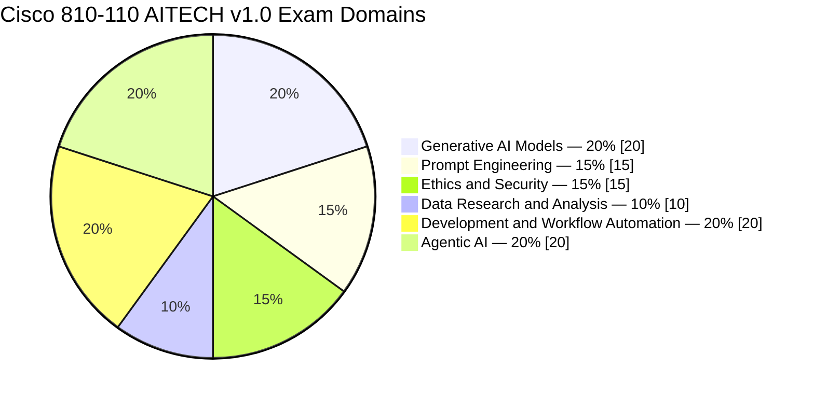
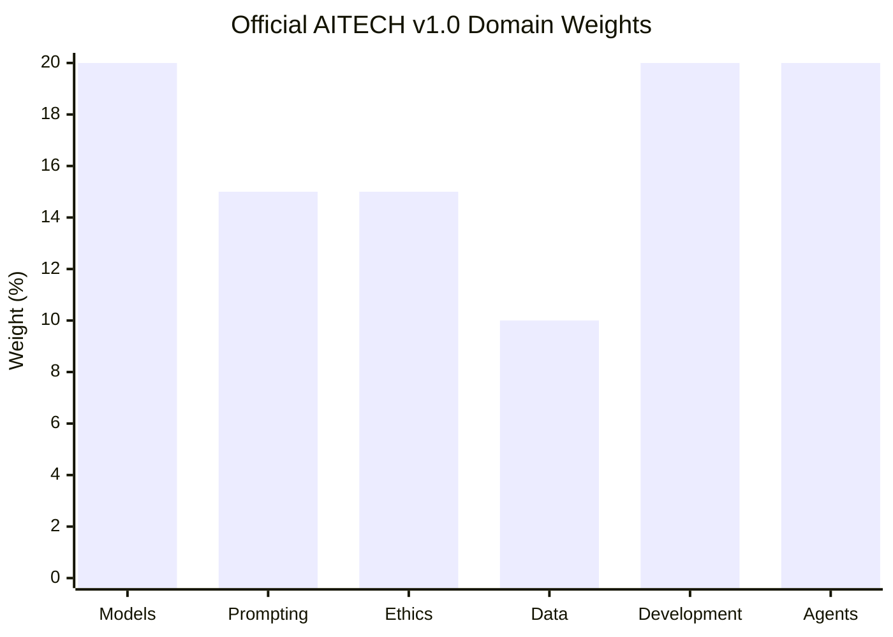
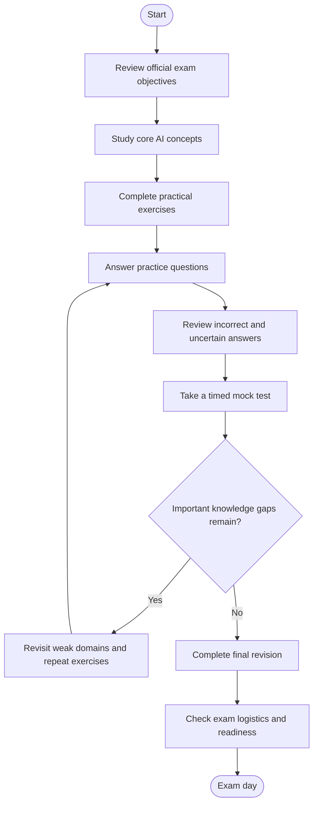
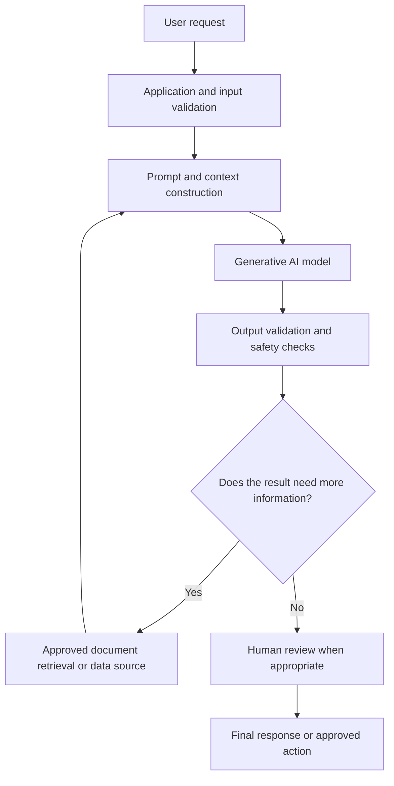
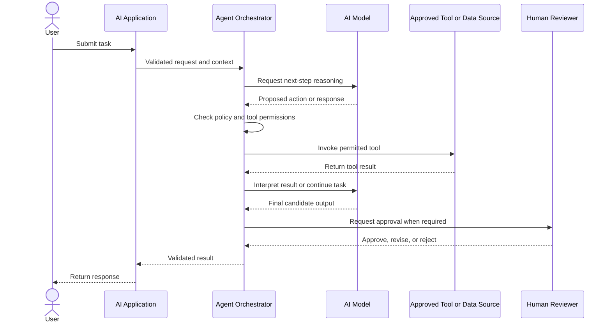
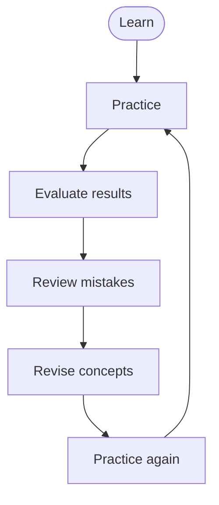

# Cisco 810-110 AITECH Study Guide — AI Technical Practitioner

Prepare for the **Cisco AI Technical Practitioner (810-110 AITECH)** certification with a structured study guide covering generative AI, prompt engineering, responsible AI, data analysis, AI-assisted software development, workflow automation, and agentic AI.

This repository brings together official exam objectives, practical learning recommendations, conceptual architecture diagrams, original practice questions, hands-on projects, and a revision roadmap. It is designed to help learners understand how AI technologies work and how to apply them responsibly in technical and business workflows.

**Exam:** 810-110 AITECH  
**Certification:** Cisco AI Technical Practitioner  
**Exam version:** v1.0  
**Exam duration:** 60 minutes  
**Exam language:** English

For the latest exam details, consult the [official Cisco exam page](https://www.cisco.com/site/us/en/learn/training-certifications/exams/aitech.html) before scheduling.

> This repository is an independent learning resource. It is not an official Cisco publication and is not endorsed by Cisco.

---

## Table of Contents

- [About the Certification](#about-the-certification)
- [Who Should Prepare for This Exam?](#who-should-prepare-for-this-exam)
- [Exam Information](#exam-information)
- [Skills and Knowledge Areas](#skills-and-knowledge-areas)
- [Official Exam Objectives](#official-exam-objectives)
- [Exam Domain Weightage](#exam-domain-weightage)
- [Certification Preparation Flowchart](#certification-preparation-flowchart)
- [How an AI Application Works](#how-an-ai-application-works)
- [Agentic AI and Tool Integration](#agentic-ai-and-tool-integration)
- [Circular Study and Revision Cycle](#circular-study-and-revision-cycle)
- [Step-by-Step Preparation Guide](#step-by-step-preparation-guide)
- [Recommended Study Schedule](#recommended-study-schedule)
- [Practice Questions and Mock Tests](#practice-questions-and-mock-tests)
- [Hands-On Labs and Practical Projects](#hands-on-labs-and-practical-projects)
- [Common Preparation Mistakes](#common-preparation-mistakes)
- [Certification Benefits and Career Relevance](#certification-benefits-and-career-relevance)
- [Frequently Asked Questions](#frequently-asked-questions)
- [Official and Additional Learning Resources](#official-and-additional-learning-resources)
- [About CertsGate](#about-certsgate)
- [Disclaimer](#disclaimer)

---

## About the Certification

The Cisco AI Technical Practitioner certification is intended to validate foundational technical knowledge related to modern AI systems and their practical use. The associated **810-110 AITECH** exam covers more than the ability to write prompts. Its published objectives include model selection, retrieval-augmented generation (RAG), AI security, data research, AI-assisted coding, workflow design, and agentic AI.

These areas are increasingly connected in real technical environments. An AI application might use a language model to interpret a request, retrieve relevant information, transform data, call an approved tool, and produce a response that a person reviews before using.

Preparing for this certification is therefore an opportunity to develop a broader understanding of AI-assisted work: what these systems can do, where they can fail, and which controls help make their outputs more reliable.

This **Cisco 810-110 AITECH study guide** uses Cisco's published exam topics as its foundation while providing independent examples and exercises to support learning.

## Who Should Prepare for This Exam?

This exam may be relevant to:

- IT professionals exploring practical generative AI applications.
- Developers interested in AI-assisted coding and prototyping.
- Data analysts using AI for research, cleaning, transformation, and exploratory analysis.
- Technical professionals learning to automate repetitive workflows.
- IT support and operations staff evaluating AI-assisted productivity tools.
- Learners interested in AI agents, tool integration, and responsible AI practices.

You do not need to assume that every topic requires advanced machine-learning mathematics. However, basic computer literacy, familiarity with common software workflows, and a willingness to experiment with AI tools will help.

If you are new to AI, begin by understanding what generative models do, what their limitations are, and how to verify their output before moving into more complex workflows.

## Exam Information

| Item | Information |
|---|---|
| Certification | Cisco AI Technical Practitioner |
| Exam code | 810-110 AITECH |
| Published version | v1.0 |
| Duration | 60 minutes |
| Language listed by Cisco | English |
| Published US price | US$150, or Cisco Learning Credits |
| Official objectives | Cisco AITECH v1.0 exam topics |
| Preparation resource | Cisco U. learning path |

Cisco can change exam details, availability, pricing, and objectives. Confirm current information directly with Cisco before booking.

The official exam page does not provide a complete public specification for every delivery detail, including a fixed question count or a numeric passing score. This guide does not assume either value.

Official reference: [Cisco 810-110 AITECH exam page](https://www.cisco.com/site/us/en/learn/training-certifications/exams/aitech.html).

## Skills and Knowledge Areas

The exam connects six main subject areas.

| Knowledge area | What to understand |
|---|---|
| Generative AI models | Model families, use cases, hosting options, context windows, embeddings, and RAG |
| Prompt engineering | Prompt structure, iterative prompting, chained prompts, few-shot examples, and defensive prompting |
| Ethics and security | Responsible AI, privacy, bias, misinformation, governance, and security threats |
| Data research and analysis | Exploratory analysis, data cleaning, transformation, research, and privacy controls |
| Development and workflow automation | AI-assisted coding, prototyping, testing, debugging, documentation, and workflow monitoring |
| Agentic AI | Agent design, orchestration, tool integration, MCP concepts, human oversight, and data mapping |

A strong preparation plan should combine definitions with practical reasoning. For example, do not only memorize what RAG stands for. Understand why an application might retrieve relevant documents before asking a model to generate an answer, and why retrieval does not automatically guarantee that the answer is correct.

---

## Official Exam Objectives

The following topics reflect Cisco's published AITECH v1.0 exam blueprint. Cisco notes that exam topics are general guidelines and may change.

### 1. Generative AI Models — 20%

Study:

- Major generative model families, including large language models and diffusion models.
- Common uses such as summarization, content generation, and code generation.
- Cloud-hosted versus locally hosted model trade-offs.
- Context windows, token limits, and response management.
- Selecting models from model hubs and repositories.
- Retrieval-augmented generation, embeddings, and vector databases.

**Preparation focus:** Be able to match a model or deployment approach to a use case while considering privacy, cost, latency, scalability, and output requirements.

### 2. Prompt Engineering — 15%

Study:

- Roles, instructions, constraints, and prompt structure.
- Iterative and sequential prompting.
- Chained prompts and few-shot examples.
- Prompt structures for text, image, and audio generation.
- Prompt injection attacks.
- Defensive prompting and mitigation of hallucinations.

**Preparation focus:** Practice turning vague requests into explicit instructions with a defined task, relevant context, output format, and constraints. Understand that a well-structured prompt can improve consistency but cannot eliminate model errors.

### 3. Ethics and Security — 15%

Study:

- Fairness, transparency, accountability, safety, and bias mitigation.
- Corporate data privacy and security.
- AI-specific threats, risks, and misinformation.
- AI governance, policies, risk management, and compliance.

**Preparation focus:** Learn to identify sensitive information, evaluate potential harm, apply appropriate safeguards, and recognize when human review is necessary.

### 4. Data Research and Analysis — 10%

Study:

- AI-assisted exploratory data analysis.
- Data quality checks, formatting, cleaning, and transformation.
- Privacy considerations and controls against data exposure.
- AI-assisted research, ideation, and content drafting.

**Preparation focus:** Understand how AI can help investigate a dataset while preserving data integrity. Verify calculations, identify missing or inconsistent values, and avoid sharing confidential data with unapproved systems.

### 5. Development and Workflow Automation — 20%

Study:

- AI's role in requirements, prototyping, implementation, testing, and deployment.
- Code generation and rapid prototyping.
- Workflow design and monitoring.
- The effects of token usage and context-window management on cost, latency, and quality.
- Debugging, error handling, documentation, and code-quality improvement.

**Preparation focus:** Treat generated code as a draft that requires review and testing. Understand the workflow around the code, not just the generated output.

### 6. Agentic AI — 20%

Study:

- Differences between generative AI use cases and agentic AI systems.
- Agent design principles and autonomous capabilities.
- Orchestration of tasks and tools.
- Model Context Protocol (MCP) framework primitives in the context of agentic AI.
- Human-in-the-loop strategies.
- Data transformation and mapping within AI agents.

**Preparation focus:** Understand how an agent receives a goal, selects or invokes tools, handles results, and decides what to do next. Pay particular attention to permissions, validation, and the boundaries of autonomous actions.

**Primary source:** [Cisco AITECH v1.0 exam topics PDF](https://learningcontent.cisco.com/documents/marketing/exam-topics/810-110-AITECH-v1.0.pdf).

---

## Exam Domain Weightage

Cisco publishes percentages for the six exam domains. The charts below reproduce those percentages from the official v1.0 blueprint.

### Official domain distribution

### Domain comparison

The largest individual allocations are Generative AI Models, Development and Workflow Automation, and Agentic AI, each at 20%. Data Research and Analysis is weighted at 10%.

Use the percentages to allocate study time, not to ignore smaller domains. A 10% domain can still expose a significant knowledge gap, especially if you have not studied data privacy or analysis practices before.

---

## Certification Preparation Flowchart

Preparation works best as a repeated process. If practice reveals that you cannot explain a concept or distinguish between similar approaches, return to the relevant material before moving on.

The diagram is an independent study recommendation, not an official Cisco examination process.

## How an AI Application Works

A useful way to study generative AI is to understand the path from a user request to a checked result. The architecture below is conceptual; it illustrates common application components rather than prescribing an official Cisco architecture.

### Important components

- **Application layer:** Accepts requests and applies input validation.
- **Prompt and context:** Supplies instructions and relevant information to the model.
- **Model:** Generates an output based on its input and learned patterns.
- **Retrieval or data source:** Provides relevant external information when the application requires it.
- **Validation:** Checks output format, permitted content, or application-specific rules.
- **Human review:** Adds oversight when an error could have meaningful consequences.

A model-generated response is not automatically factual or safe. Applications need appropriate verification, privacy controls, and access boundaries.

## Agentic AI and Tool Integration

Agentic AI can go beyond generating a response by coordinating multiple steps and interacting with tools. The amount of autonomy depends on the system design and the permissions granted to it.

### Where MCP fits

The Model Context Protocol (MCP) is a framework for connecting AI applications with external tools and context sources through defined interfaces. For exam preparation, focus on the role MCP plays in agentic systems and understand the relevant primitives described in the official blueprint.

Do not assume that an agent or MCP connection should automatically receive broad system access. Tool permissions, input validation, sensitive-data handling, and human approval remain important design considerations.

---

## Circular Study and Revision Cycle

AI concepts are easier to retain when you repeatedly apply them and investigate mistakes. Use this cycle throughout your preparation rather than waiting until the final days to review weak topics.

For each practice session:

1. Record the topic and your answer.
2. Explain why the answer is correct or incorrect.
3. Identify the exam objective involved.
4. Revisit documentation or perform a small experiment.
5. Try a different question or scenario.
6. Recheck the topic later to confirm that you retained it.

This approach helps distinguish real understanding from familiarity with a question's wording.

## Step-by-Step Preparation Guide

### Step 1: Start with the official blueprint

Read the official exam topics document from beginning to end. Turn each numbered objective into a checklist. Mark every item as **not studied**, **in progress**, or **ready for review**.

This checklist should determine your study priorities.

### Step 2: Build a foundation in generative AI

Learn the differences between language models and diffusion models, and identify the types of tasks for which each can be useful.

Understand the practical trade-offs between local and cloud-hosted models. Review tokens, context windows, embeddings, vector databases, and RAG. Be prepared to explain how these components relate rather than memorizing isolated definitions.

### Step 3: Practice prompt engineering

Use one task with several prompt designs. Start with a vague instruction, then add context, constraints, examples, and a required output format.

Compare the results. Look for unsupported claims, missing details, inconsistent formatting, and sensitive information that should not be included.

Also study prompt injection and defensive measures. A prompt alone is not a complete security boundary.

### Step 4: Study responsible AI and security

Work through scenarios involving confidential business information, biased outputs, misinformation, and unclear accountability.

Ask yourself:

- What information is sensitive?
- Who is authorized to access it?
- How could an AI response cause harm?
- What evidence is needed to validate the result?
- Where should a human approve or reject an action?

### Step 5: Explore AI-assisted data analysis

Use a small, non-sensitive dataset. Inspect its columns, identify missing values, check inconsistent formats, and summarize patterns.

If AI helps generate a transformation or analysis, verify the result independently. Do not assume that a plausible explanation or generated chart accurately represents the underlying data.

### Step 6: Use AI in a software workflow

Try using an AI assistant to draft a small function, generate test cases, explain an error, or improve documentation.

Review the code before execution. Test normal inputs, invalid inputs, boundary conditions, and unexpected values. Keep secrets and credentials out of prompts and source code.

### Step 7: Understand agentic workflows

Break a task into a series of steps: interpret the goal, select a permitted tool, validate inputs, execute an action, inspect the result, and decide whether another step is necessary.

Identify where the system should stop and request human approval. Study the MCP-related objectives using Cisco's exam topics rather than relying solely on informal descriptions of agents.

### Step 8: Assess readiness

Use practice questions and timed sessions to find weak areas. Revisit objectives that you cannot explain without notes.

Before scheduling or taking the exam, review the current official exam page for any updates.

---

## Recommended Study Schedule

The following is an **illustrative six-week plan**, not an official Cisco requirement. Adjust it to your background, available time, and results from practice.

| Week | Main focus | Suggested activity |
|---|---|---|
| 1 | Exam objectives and generative models | Create the objective checklist; compare model types, hosting, context limits, and RAG |
| 2 | Prompt engineering | Test prompt structures, few-shot examples, chained prompts, and defensive approaches |
| 3 | Ethics, security, data analysis | Review privacy scenarios and work with a small sample dataset |
| 4 | Development and automation | Build a small AI-assisted coding workflow and verify its outputs |
| 5 | Agentic AI and integration | Design a tool-using workflow with permissions and human approval |
| 6 | Assessment and final revision | Take timed practice sessions, analyze errors, and revisit weak objectives |

A steady routine is generally more useful than rushing through all topics in one sitting. Even a short session can be productive when it includes focused study, active practice, and review.

## Practice Questions and Mock Tests

Practice questions are useful when they test your reasoning rather than your ability to remember a particular answer pattern.

The examples below are **original learning questions written for this repository**. They are not actual, leaked, or official Cisco exam questions.

### Question 1: Model deployment

A team needs to process sensitive internal information and is comparing a cloud-hosted model with a locally hosted model. What should it evaluate?

A. Only the model's public popularity  
B. Privacy, security, cost, latency, and scalability  
C. Only the length of the model's name  
D. Whether the model can avoid every possible error

**Answer: B**

**Explanation:** Hosting decisions involve trade-offs. Privacy requirements, operational cost, latency, security, and available resources all affect the choice. Neither hosting approach guarantees perfect results.

### Question 2: Retrieval-augmented generation

What is a primary purpose of RAG?

A. To remove the need to evaluate model outputs  
B. To retrieve relevant information that can be supplied as context to a generative model  
C. To guarantee that every generated response is correct  
D. To replace all databases with a language model

**Answer: B**

**Explanation:** RAG combines retrieval with generation. It can provide relevant context, but retrieved information and the final answer still need suitable validation.

### Question 3: Prompt injection

An AI application retrieves external documents. One document contains instructions that conflict with the application's intended behavior. What is the best general design principle?

A. Treat all retrieved text as trusted system instructions  
B. Remove all access controls to simplify processing  
C. Treat retrieved content as untrusted data and enforce policy and permission checks outside the model's instructions  
D. Assume the model will always identify malicious content correctly

**Answer: C**

**Explanation:** Retrieved content can contain malicious or irrelevant instructions. Clear trust boundaries, application-level controls, and restricted permissions are important defenses.

### Question 4: AI-assisted coding

An AI assistant generates a function that appears to solve a problem. What should a developer do next?

A. Deploy it without testing  
B. Review the code and test expected, invalid, and boundary inputs  
C. Assume generated code is secure because it compiles  
D. Remove error handling to keep the function short

**Answer: B**

**Explanation:** Generated code can contain logical errors, insecure assumptions, or missing edge cases. Human review and testing remain essential.

### Question 5: Agentic AI

An agent is asked to update records in a production system. Which design choice is most appropriate when changes have significant consequences?

A. Grant unrestricted permissions to every tool  
B. Let the agent skip validation to save time  
C. Apply least-privilege access, validate proposed changes, and require approval where appropriate  
D. Assume the model's confidence guarantees a safe action

**Answer: C**

**Explanation:** Tool access should be limited to what the task requires. Validation, auditability, and human-in-the-loop controls help reduce the risk of unintended changes.

### How to use a mock test

After each practice session:

1. Check every answer, including the answers you guessed correctly.
2. Write down the reasoning behind each mistake.
3. Link each mistake to one of the six official exam domains.
4. Review the relevant documentation or repeat a practical exercise.
5. Try new questions to see whether you understand the concept beyond the original wording.
6. Repeat the assessment after addressing weak areas.

A mock-test score is a study signal, not a guarantee of the result on the official exam.

## Hands-On Labs and Practical Projects

Hands-on work can make abstract AI concepts easier to understand. Use approved tools and non-sensitive sample data, and check the licensing and usage terms of any model or service you select.

### Lab 1: Compare generative model use cases

Choose several example tasks, such as text summarization, code generation, and image creation.

For each task, record the model family you would consider, the expected output, and the trade-offs that matter. Explain why one approach might be more suitable than another.

### Lab 2: Build a prompt evaluation worksheet

Create a worksheet with these columns:

| Field | Purpose |
|---|---|
| Task | Defines what the model should accomplish |
| Context | Supplies relevant background information |
| Constraints | Limits the scope or behavior |
| Output format | Specifies the desired structure |
| Evaluation criteria | Defines what a useful result must contain |
| Observed issues | Records errors, omissions, or unsupported claims |

Compare several prompts for the same task and document which changes improved the output.

### Lab 3: Create a small RAG prototype

Use a few public or self-created documents.

1. Split documents into manageable passages.
2. Generate embeddings using an appropriate tool.
3. Store embeddings in a vector index or vector database.
4. Retrieve passages relevant to a test question.
5. Supply retrieved passages to a generative model.
6. Check whether the answer is supported by the retrieved material.

Test questions that cannot be answered from the documents. The system should handle missing evidence appropriately rather than confidently inventing details.

### Lab 4: Analyze a sample dataset

Use a public dataset or create a small synthetic dataset. Identify missing fields, inconsistent formats, duplicate records, and unusual values.

Ask an AI assistant to suggest cleaning or analysis steps, then verify the results using a reproducible process. Document the transformations and any assumptions.

### Lab 5: Develop and test a small utility

Choose a simple programming task, such as validating a CSV file or converting structured data into a standard format.

Use AI to draft code or test cases. Inspect the implementation, test edge cases, and document any changes needed to make the result reliable.

### Lab 6: Design a controlled AI agent

Create a conceptual agent that can search an approved knowledge source and prepare a draft report.

Specify:

- The permitted tools and data sources.
- The information the agent is allowed to access.
- The expected input and output formats.
- How tool results are validated.
- When the agent must stop or request approval.
- How actions and errors are recorded.

You can begin with a diagram or simulated workflow; a production deployment is not required to learn the design principles.

### Capstone project: AI-assisted research workflow

Build a small prototype that accepts a research question, retrieves relevant public documents, summarizes the findings, and produces a structured report with references.

A useful implementation should include:

- Input validation.
- A clearly defined prompt and output format.
- Retrieval of relevant material.
- Validation that cited sources support the summary.
- Error handling for missing or unavailable information.
- A final review step before the report is used.

This project connects model selection, prompting, data handling, workflow design, and responsible use.

---

## Common Preparation Mistakes

### Studying prompts without learning model fundamentals

Prompting is only one part of the blueprint. Review model families, context limits, hosting choices, embeddings, and RAG as well.

### Treating AI-generated content as verified fact

A fluent answer can still be wrong. Check calculations, code, summaries, and technical claims against reliable evidence.

### Ignoring ethics and privacy

Understand the risks of exposing corporate data, using biased outputs, or acting on misinformation. Learn to identify appropriate controls.

### Memorizing practice answers

Question wording can change. Focus on why an answer works and when a different technical approach would be appropriate.

### Overlooking agent permissions

An agent that can call tools may affect real systems. Study access boundaries, input validation, human approval, and monitoring.

### Leaving weak domains until the end

Use the official percentages to guide time allocation, but revisit every objective that you cannot explain or apply confidently.

### Relying on one preparation resource

Use the official blueprint as your checklist. Combine documentation, practical exercises, structured training, and independent practice questions where useful.

---

## Certification Benefits and Career Relevance

The Cisco AI Technical Practitioner certification can provide a structured way to study practical AI concepts and demonstrate knowledge associated with the exam objectives.

The subject areas may be relevant to work involving:

- AI-assisted software development.
- Technical research and content synthesis.
- Data preparation and exploratory analysis.
- Productivity and workflow automation.
- AI application design and evaluation.
- Responsible AI implementation and operational controls.

The value of the certification will depend on your existing skills, the roles you pursue, and how well you can apply the concepts. A certification is not a substitute for project experience, sound technical judgment, or continued learning.

A small portfolio of carefully documented projects can complement exam preparation by showing how you evaluate outputs, handle data, test software, and apply safeguards.

## Frequently Asked Questions

### What is the Cisco 810-110 AITECH exam?

It is the exam associated with the Cisco AI Technical Practitioner certification. Cisco's published v1.0 objectives cover generative AI models, prompt engineering, ethics and security, data research and analysis, development and workflow automation, and agentic AI.

### How long is the 810-110 AITECH exam?

Cisco lists a duration of 60 minutes. Check the official exam page for current details before booking.

### What are the official exam domains?

The six domains are Generative AI Models, Prompt Engineering, Ethics and Security, Data Research and Analysis, Development and Workflow Automation, and Agentic AI.

### What is the best way to prepare for 810-110 AITECH?

Begin with Cisco's official exam topics, study each domain, practice relevant workflows, and use questions to identify gaps. Revisit incorrect answers and verify your understanding with documentation and practical exercises.

### Does the exam cover agentic AI and MCP?

Yes. Cisco's published v1.0 objectives include agent design, autonomous capabilities, orchestration, Model Context Protocol (MCP) framework primitives, human-in-the-loop strategies, and data transformation within agents.

### Are practice questions in this repository official exam questions?

No. The sample questions in this repository are original educational examples. They are not represented as official, actual, or leaked Cisco exam questions.

### Is a passing score published?

The public exam page and topic document linked here do not specify a numeric passing score. Check Cisco's current exam information for any updated guidance.

### How long should I study?

There is no single schedule that fits every learner. The six-week roadmap in this repository is a suggested structure, not a Cisco requirement. Adjust it based on your familiarity with AI concepts and your progress through the official objectives.

### Can CertsGate replace Cisco's official learning materials?

No. Use Cisco documentation and the official exam blueprint as your primary reference. Independent resources can supplement study and provide additional opportunities to practice.

---

## Official and Additional Learning Resources

Use official Cisco sources to confirm the current blueprint, exam details, and available training.

### Official Cisco resources

- [Cisco 810-110 AITECH exam page](https://www.cisco.com/site/us/en/learn/training-certifications/exams/aitech.html) — exam duration, listed language, price, and preparation options.
- [Cisco AITECH v1.0 exam topics PDF](https://learningcontent.cisco.com/documents/marketing/exam-topics/810-110-AITECH-v1.0.pdf) — official domains, subtopics, and published weightings.
- [Cisco AI Technical Practitioner certification and training](https://www.cisco.com/site/us/en/learn/training-certifications/certifications/ai/technical-practitioner/exam.html) — certification and training information.
- [Cisco U. AI Technical Practitioner learning path](https://u.cisco.com/paths/cisco-ai-technical-practitioner-20806) — structured learning for the exam.
- [Cisco AI Technical Practitioner training course](https://www.cisco.com/site/us/en/learn/training-certifications/training/courses/aitech.html) — course information and intended audience.
- [Cisco exam list](https://www.cisco.com/site/us/en/learn/training-certifications/exams/list.html) — check the current exam listing.

---

## About CertsGate

[CertsGate](https://certsgate.com/) is an independent website for IT certification preparation. Learners can explore the available catalog for study guides, practice questions, mock-test-style exercises, and other learning material relevant to their certification goals.

For the Cisco 810-110 AITECH exam, use any relevant CertsGate material as a supplement to the official Cisco exam topics and your own practical exercises. Review explanations carefully, identify weak areas, and confirm technical details with authoritative documentation.
